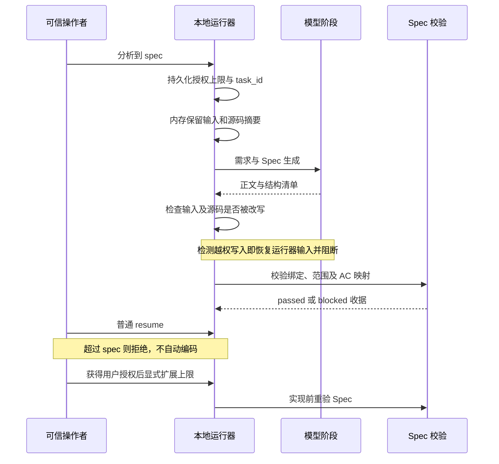

# 本地运行器：授权恢复、领域分离与 Spec 内容门禁

日期：2026-10-21。范围：awesome-factory 公共本地模板及 gtsp-wop-admin 已安装运行器。未实施试点业务需求，不提交、不推送、不启动远端交付。

## 结果与依据

本轮只补齐三项：恢复不得越过原授权、技术领域不因分析模式丢失、非空 Spec 必须通过内容和输入绑定检查。此前 admin 试点在 Spec 后留下 implement 恢复入口，但缺少持久化授权；分类将前端分析归为 analysis，丢失前端验收属性；Spec 仅有非空检查。

本轮规格依据为用户确认的三项要求；标准依据为公共运行器的 fail-closed、阶段快照、原子状态写入和本地无远端副作用约束。审查固定点为同步前 admin 安装摘要所绑定的 .factory/run.py，SHA-256 为 79ed2c5b9476276f0e9cfbfd2a654348ea05f8f7169c8d28d9131fc9d10953a5。现有公共仓其他未提交内容不属于本轮增量。

## 修改契约

| 项目 | 新行为 | 阻断条件/结果 |
| --- | --- | --- |
| 恢复授权 | authorization.json 绑定 task_id、请求摘要、authorized_end_stage 和 CLI 授权历史 | 普通 resume、from-stage、only-stage 不能扩大上限；越界 rc=2，保留旧状态、旧 attempt 和旧产物 |
| 授权缺失迁移 | 旧任务普通恢复直接拒绝 | 维护者明确指定上限并从 classify 重跑；不悄悄赋予编码权限 |
| 达到授权上限 | 状态 awaiting_authorization，仍保留后续阶段名 | 只有操作者在获得用户授权后显式传 --authorize-through 才能扩展；生成恢复命令不附授权参数 |
| 领域与模式 | classification/4：domain/scope=frontend/backend/fullstack/unknown；execution_mode=analysis/development | 分析任务自动止于 spec；前端/全栈的浏览器和设计验收属性继续保留 |
| Spec 内容 | spec-input.json 为运行器输入；spec.md + spec-contract.json 为模型输出；spec-validation.json 为运行器校验收据 | 缺失、格式错误、绑定漂移、范围非法、验收映射缺失、冒称测试通过均拒绝完成 Spec 或进入实现 |
| 模型写入边界 | 每次模型调用前在内存保留授权、身份、需求和已有 Spec 输入；调用结束含异常时检查并原子恢复被改写的运行器输入 | 写 stage-integrity.json，rc=2；需求/Spec 修改源码时同样阻断，保留源码现场待检查，不自动回退 |

首次 --only-stage 的值成为默认上限；分析意图将默认上限限制到 spec。无分析限制且未指定 only-stage 的普通开发任务默认可运行到 verify。CLI 授权来源是可信操作者，不是签名审批系统；本轮不提供对恶意本机进程的 OS 沙箱。模型的工具允许列表继续为 read/write/edit/grep/lsp，不扩大现有能力。

## Spec 清单

schema 为 factory-local/spec-contract/1，必填内容如下：

- task_id、request_sha256、requirement_sha256、source_sha256：与运行器输入一致；输入中的源码摘要须与当前工作树一致。
- goal：非空目标。
- scope.allowed_files：项目相对文件，规范化后检查周界；拒绝根目录、目录、绝对路径、父路径、越界符号链接、.factory 和 MISSION 等治理文件。允许声明尚未新建的业务文件。
- scope.non_goals：非空非目标列表。
- acceptance：唯一 AC ID、可观察 criterion、有效 verification_ids；每个 AC 至少映射一种 required=true 的验证。
- verification：唯一 ID、kind=command/manual、argv/steps、environment=local/mock/test-environment、required 布尔值、status=NOT_RUN。
- external_requirements：显式数组，可为空；条目含 description 和 PENDING/AVAILABLE。
- Spec 正文含 task_id、AC ID、允许修改文件路径，便于人读稿与机器清单核对。

校验器不执行模型声明的 argv。结构通过不等于业务语义正确、人工批准、测试执行成功、视觉还原通过或测试环境验收完成。需求仍需评审，后续实现与验收仍需各自的真实证据。

## 使用与恢复

先完成需求与 Spec：

```bash
python3 .factory/run.py --task example --request-file /path/to/request.md --only-stage spec
```

用户确认可进入实施后，操作者显式授权：

```bash
python3 .factory/run.py --task example --request-file /path/to/request.md --resume --authorize-through verify
```

若是缺少 authorization.json 或旧分类/旧 Spec 契约的历史任务，普通恢复会拒绝。确认需要重做分析后可明确收紧上限，从 classify 重新执行；原 attempts 保留。不要手改旧历史快照来伪造兼容，不在原试点上自动执行模型重跑。

## Standards 审查

独立规范轴发现并复现：模型改写授权可使普通恢复进入编码；Spec 改写源码后刷新自身输入可掩盖漂移；./.factory 与 ./MISSION 路径别名可绕过周界。聚合方核对运行器调用路径与负例，补充模型边界检测、源输入保留、规范路径比较。恢复输入由临时文件加 replace 原子写入。最终复查 findings=[]。

## Spec 审查

独立规格轴发现并复现授权改写、源码输入改写两项 P1，均已修复；负向执行意图与非法输入 JSON 根类型问题也已修复。最终复查 findings=[]。审查使用隔离临时仓和假模型，不代表真实模型任务验收。

## 验证与记录

最终命令、退出码、用例统计及 admin 核对结果见 admin 的 artifacts/factory-local/runtime-hardening-20261021/summary.json。过程中发现并修复了 pytest 保留参数名导致收集失败，以及两项旧断言不再符合“恢复拒绝时保留旧状态”的新契约；不会把这些初次失败隐去或记为通过。

已验证的关键防线：授权越界在模型调用前拒绝，旧任务缺授权不直接编码，前端分析保留浏览器要求，非空坏 Spec 被拦截，合法 Spec 收据与产物一并归档，模型篡改运行器输入含异常分支被拦截，验证计划只做校验不执行。测试包括临时仓真实 CLI、恢复、中断、初始化和完整性检查。

未覆盖：真实 OMP 新任务调用、浏览器交互、Figma、真实接口、测试环境、MR 和流水线。本轮没有宣称试点需求已实现或验收通过。尚待后续：统一阶段验收契约全接入、远端否定意图误报、技能过量命中、逐阶段退出码与 NOT_REQUIRED 明细。



图仅表达已核对的本地控制流；渲染检查记录在本轮执行结果中。

## 最终验证结果

| 验证节点 | 结果 |
| --- | --- |
| 最终回归：运行器、接入、初始化、项目类型 profile | 117 passed，130.65 秒，退出码 0 |
| admin 安装摘要、策略、工具、guard、mutation 检查 | 全部通过，退出码 0 |
| admin 新任务真实分类 | frontend + analysis + needs_browser_acceptance=true，退出码 0，无模型调用 |
| admin 普通恢复越界 | 按预期返回 2，原状态保持不变 |
| admin 历史试点普通恢复 | 缺少授权记录，按预期返回 2，未进入编码 |
| 工作区摘要核对 | 435 文件中仅 4 项基础设施/说明变更，431 项原样，无新增/删除，业务源码变更 0 |
| 历史证据核对 | 原试点 31 个文件摘要全部保持一致，另追加拒绝恢复审计 |
| 安装来源与同步 | 公共模板与 admin 安装文件逐字节一致，安装摘要全部匹配，原上游来源记录保留 |
| 独立双轴复核 | Standards 0 条残余发现，Spec 0 条残余发现 |
| Python 编译、双仓 diff 空白检查、Mermaid 渲染 | 全部退出码 0 |

测试原始日志、逐节点退出码、修改前备份、前后文件摘要、复核记录与迭代中的失败原因均在 admin 的 artifacts/factory-local/runtime-hardening-20261021/。接入自检完整记录在 artifacts/factory-local/onboarding/20261021T040807Z-f9d0f779/。本轮没有实际模型调用，未提交或推送。
