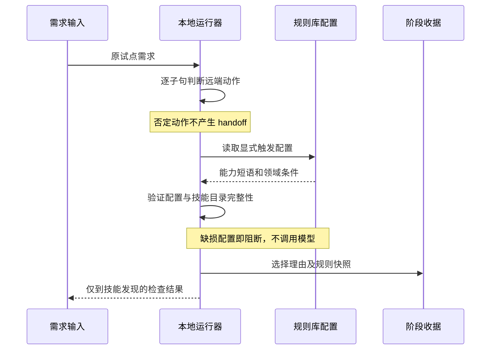

# 本地 Factory：远端否定意图与技能选择修复

2026-10-21。本轮只调整 awesome-factory 通用路由器、awesome-rules 技能触发数据及 admin 安装副本，不修改业务源码，不提交或推送。

## 问题与职责

原远端识别只看动作前 12 字符；试点的“不要启动实现、全量质量门或远端交付”超出窗口，产生不必要 handoff。原技能选择将需求与技能 description 分词后取交集，“接口”“任务”“Factory”等背景词造成 9 项技能误选。

Factory 负责通用语句判断、读取声明式配置、选择和快照；awesome-rules/skills/factory-routing.json 维护每个技能的实际适用触发条件，技能正文定义如何执行。新增能力不把技能描述全文交集重新带回运行器。

## 实现

- 远端动作逐项记录 affirmed/negated/excluded、文本位置及理由。否定覆盖完整子句和协调列表，含跨逗号的非远端动作；中文/英文句号、明确转折或独立新指令界定范围。
- “仅推送”“不要推送，但创建 MR”保留肯定部分；“未处理的错误”不作为动作禁令；“请求”中的“请”和被禁止动作的时间状语不得解除否定。
- 非目标章节和 fenced 示例被排除；用户明确要求“执行以下命令”的代码块保留动作。此识别只生成 handoff，不授予本地远端执行权限。
- 技能选择只由规则库声明的明确能力短语、肯定的显式技能名/路径、设计输入与领域条件、固有治理能力触发。不用描述词交集。
- 设计输入支持前置与后置否定；明确指定一个设计技能，不自动增选另一个设计技能。
- 规则文件必须非空、目录与配置双向一致、每项有有效条件；仅手动技能需显式 explicit_only=true。缺失、损坏、空规则或缺项在模型调用前阻断。
- skill-selection/2 包含规则摘要、选择理由和逐项判断；skill-routing.snapshot.json 纳入阶段快照。v1 选择或当前规则摘要改变须从 classify 重跑，不直接沿用旧选择进入实施。

默认规则在本地任务保留 factory-acceptance。明确 API 审查、日报、设计稿还原或指定其他技能时仍能选中相应能力。规则契约与新增配置方式见 awesome-rules/skills/factory-routing.md。

## 验证方法

回归覆盖原长否定、中文/英文协调列表、转折、句号、肯定动作保留、非目标、命令/示例代码块、描述性未/尚未、时间状语、显式技能、背景词、真实设计输入、缺损配置、配置变化恢复阻断，以及先前授权/Spec/初始化回归。

admin 使用同一份真实试点 request.md 新建只到 skill-discovery 的检查任务；不重跑付费模型，不覆盖上次成功的 requirement/spec。真实规则矩阵补充 API、日报、Figma、显式单技能和肯定交付的正例。同步前后核对安装摘要及全部业务文件；原试点历史文件逐一核对。

## Standards 审查

独立审查复现了英文句号泄漏、执行代码块误屏蔽、设计输入后置否定、空规则，以及肯定重置过宽的问题；修复并增加对应回归。最终复查结果与执行日志写入本轮 summary.json。审查基线为 admin 同步前的运行器备份（其摘要见 sync.json），不把其他先前未提交改动算入本轮。

## Spec 审查

独立审查复现跨逗号列表失去否定、“未处理”状态词抹掉肯定、配置缺项和“请求”中“请”误重置；均已修复并覆盖回归。测试通过只能证明已覆盖语句，不代表通用自然语言理解。

## 证据边界与遗留

已验证：通用匹配、配置结构、正反例、本地 CLI 和文件摘要。未覆盖：真实模型重跑、业务实现、业务测试、浏览器、测试环境、代码托管/流水线交付。本轮未触及这些阶段。

仍是确定性规则，不处理所有语言与双重否定；含混指令应改写为独立、明确的肯定或否定句。本地运行器始终没有远端执行权。规则库完全不可用时的原有 unavailable 行为保留，不能声称完整规则已加载。技能正文变化的恢复绑定、逐阶段退出码/NOT_REQUIRED 原生事件、统一七阶段契约接入不在本轮范围。

审查要求的技术时序图如下，语法渲染与最终测试结果见 admin artifacts/factory-local/intent-skill-hardening-20261021/。

## 最终结果

| 节点 | 结果 |
| --- | --- |
| 运行器、授权/Spec/恢复、初始化/profile 与规则仓回归 | 173 passed，174.14 秒，退出码 0 |
| 针对性回归 | 56 passed（含规则库配置检查）；独立覆盖采集的运行器新增用例为 54 项 |
| 本轮变更代码覆盖 | 行 95.97%（143/149），分支 90.00%（72/80）；仅相对同步前运行器新增/变更代码，不冒称全仓覆盖 |
| admin 新安装检查 | 安装完整性、策略、guard、mutation 全通过 |
| 原试点真实 CLI 回放 | 远端意图 false、无 handoff；扫描 16，选择仅 factory-acceptance；frontend/analysis/浏览器要求仍保留 |
| 真实规则库正反矩阵 | 9/9 通过，包含肯定交付、转折、API、日报、设计输入和显式单技能 |
| 独立审查 | Standards / Spec 最终均 findings=[] |
| 范围核对 | admin 仅运行器/说明/安装摘要 3 文件变化；原试点 116 文件全部未变；业务代码 0 变更 |
| 编译、三仓空白检查、时序图渲染 | 全部退出码 0 |

本轮 admin 回放任务为 pilot-intent-skill-check-20261021，task_id local-20261021-26d60961，attempt_id 20261021T112526-d74dd3fb2781；只执行 classify 和 skill-discovery，未调用模型。原需求/Spec 成功运行记录保持历史原样。所有原始输出、修改前备份、规则快照、迭代失败及修复记录见 admin artifacts/factory-local/intent-skill-hardening-20261021/summary.json 及同目录文件。未提交、推送或触发远端交付。
